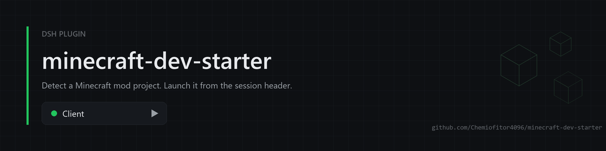
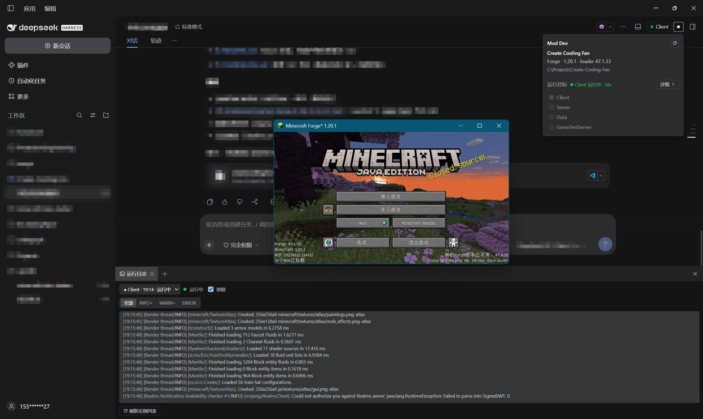
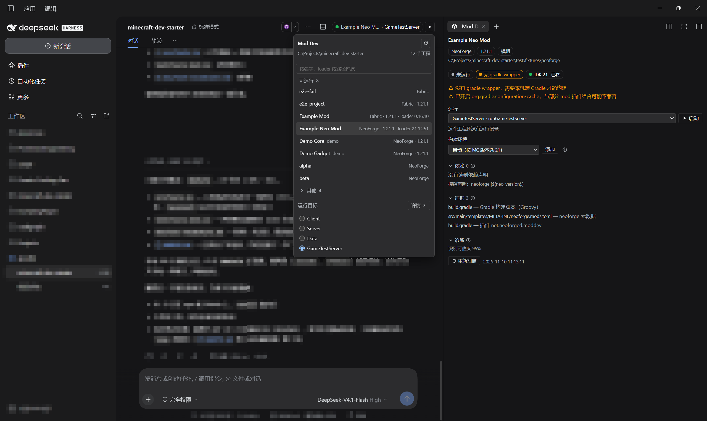

<div align="center">



# minecraft-dev-starter

**Run and verify Minecraft mod builds from the DeepSeek Harness session header.**

English | [简体中文](README.zh_CN.md)

<p>
  <a href="https://github.com/Chemiofitor4096/minecraft-dev-starter/actions/workflows/ci.yml"></a>
  <a href="https://www.npmjs.com/package/minecraft-dev-starter"></a>
  
</p>

</div>

The plugin detects Minecraft mod and plugin projects in the current workspace, offers run-target selection plus start/stop controls in the session header, and streams launch logs into a sidebar tab.

The panel serves people, the tools serve the model, and both share one run state and one lock: a project has at most one instance, whoever started it, and neither side kills the other's process.

Run targets have two lifecycles. `runClient` / `runServer` are daemons that keep running until the window is closed; `runData` / `runGameTestServer` finish and produce a pass or fail verdict. That is what lets the model close its own "change code → run it → read the verdict" loop instead of asking a human to judge a game window.

## Screenshots





## Features

- **Project detection**: Fabric, Forge, NeoForge, Architectury, Paper and Spigot, from Minecraft 1.7.10 to 26.x. Single-module, multi-module and composite builds are supported, including repositories that declare their loader only in a submodule.
- **Project scaffolding**: `mc_mod_init` turns an empty directory into a buildable mod project (Fabric or NeoForge). It resolves the loader, mappings, plugin and API versions from upstream at call time, writes the Gradle files and a mod entrypoint, and refuses a non-empty directory.
- **Run targets**: extracted from the Gradle build, split into `daemon` and `oneshot`. Targets inferred by loader convention are marked unverified, and remain selectable and launchable.
- **Managed launches**: tasks are started through the Gradle wrapper. Daemons become "running" when their readiness markers appear in the log, not merely when the process is alive; one-shot tasks report success, failure, being stopped, or failing to start as distinct outcomes. Stopping kills Gradle and its whole process tree.
- **JDK selection**: the required JDK major is inferred from the Minecraft version and `toolchain`. The panel lists the JDKs found on this machine and can also register a JDK root directory you type in. Choices stay local (`~/.dsh/mc-dev-starter/jdk.json`), never in `gradle.properties`, and are passed to Gradle as `-Dorg.gradle.java.home` plus `JAVA_HOME`, so what the panel shows is what actually runs. Automatic selection only takes over when the major version matches exactly and the wrapper's Gradle can run it.
- **Declared dependencies**: `dependencies { }` blocks, `gradle/libs.versions.toml` and the metadata `depends` are parsed and shown with configuration, coordinate and `file:line`, so you can confirm that a dependency was really added. Only declarations are shown — resolved transitive graphs require running Gradle. When IntelliJ has synced the project, each declaration is also compared with the version from the IDE's library table (no Gradle run); "actual x.y.z" is informational, not an error.
- **Bilingual UI**: the panel, the flyout, the capsule and the log tab follow the DSH language setting (English / Chinese), including relative times and the probable-cause lines. Loader names, project paths and Gradle task paths are never translated.
- **State persistence**: run records are stored per profile (`~/.dsh/mc-dev-starter/profiles/<name>/`), so profiles do not see each other's instances. After a host restart records are reconciled against the process id; when liveness cannot be confirmed the outcome is reported as unknown instead of being invented.
- **Run logs**: a sidebar tab, or a better-sidebar bottom workbench. Launch history per project, follow mode, level colouring (WARN and ERROR highlighted, stack frames and Gradle task lines distinguished, timestamps and loggers de-emphasised) and level filtering (All / INFO+ / WARN+ / ERROR) that is remembered. Abnormal exits come with a probable cause: dependency resolution, JDK mismatch, port in use, authentication failure.
- **Workspace following**: the workspace is the current session's working directory; switching sessions rescans automatically. When the workspace has no runnable project the header capsule is not rendered, so it does not take up space in non-Minecraft projects; the panel tab stays available.
- **Model tools** (optional): eight tools backed by the same service as the panel — `mc_projects` (projects and targets), `mc_project_detail` (loader evidence, modules, JDK, declared dependencies, targets with their modes), `mc_mod_init` (scaffold a new Fabric or NeoForge project into an empty directory), `mc_set_group` (rename the Java package of a scaffolded project), `mc_launch` (start; daemons wait for readiness, one-shot targets wait for completion and return a `verdict` plus failing lines; accepts `offline`, `refreshDependencies` and `-D` properties for proxy or cache problems), `mc_launch_logs` (log tail with structured diagnosis), `mc_launch_list` (history including verdicts), `mc_launch_stop` (kill the process tree). Apart from `mc_projects` and `mc_mod_init`, a tool is only declared when the workspace really holds a runnable Minecraft project (per-step activation, which keeps the tool schemas out of the window; needs DSH 0.2.2+).
- **Sidebar tabs**: the Mod Dev panel and the run log open as their own tabs, each with an icon (a grass block and a scroll), in the native right sidebar as well as in `dsh-better-sidebar`.
- **Optional integration**: with [dsh-better-sidebar](https://github.com/topics/dsh-better-sidebar) installed, the panel and the log open as icon tabs in its sidebar.

## Installation

Requires DSH Desktop 0.2.1 or newer, or the matching `dsh` CLI. 0.2.2+ additionally enables per-step tool activation, so the model tools load only in workspaces that really hold a runnable project.

```powershell
# From npm
dsh plugin --profile desktop add minecraft-dev-starter

# Local repository (edits take effect immediately)
dsh plugin --profile desktop add link:C:/Projects/minecraft-dev-starter

# From a packed tarball
dsh plugin --profile desktop add file:./minecraft-dev-starter-0.2.0.tgz
```

Restart DSH afterwards. To uninstall:

```powershell
dsh plugin --profile desktop remove minecraft-dev-starter
```

`dsh plugin` is a wrapper around pnpm: it adds the plugin to the profile's dependencies and appends packages that declare `dsh.bundle` to `dsh.profile.bundles`. Editing the profile's `package.json` and running `pnpm install` has the same effect.

## Usage

1. Open a session whose workspace contains a Minecraft project.
2. The header shows the currently selected run target. Click its name to open the flyout and pick a project and task.
3. To change the JDK, use the "Build environment" section of the "Mod Dev" panel: pick one of the detected JDKs, or type a JDK root directory and add it.
4. Press play to build and run. The run log tab opens automatically; this can be disabled by configuration.
5. While running, the button turns into stop, which terminates Gradle and its children.

Flyout layout follows the number of projects: a single-project workspace skips the project list and lets the header carry the project identity (name, loader and version, path); a multi-project workspace shows a fixed-height list, and switching projects only updates the target area below it, so the page does not jump.

### Verifying changes

For targets that finish, the model gets a verdict without anyone watching a window:

1. `mc_project_detail` shows which targets are `oneshot` — `runData`, `runGameTestServer`, and any `runGametest` defined by the project;
2. `mc_launch` starts one. These targets wait for completion by default and return a `verdict`: `passed` / `failed` / `aborted` / `error`;
3. on failure, `summary` is the first failing line and `failures` holds the matched lines; `mc_launch_logs` reads the rest.

What a daemon (`runClient`) can assert automatically is whether it reached the running state and whether the log contains exceptions. Visuals and feel stay a human judgement: the model starts the client, a human looks, then the model goes back to the log.

## Configuration

Add a `config` block to the plugin entry in the profile's `cordis.patch.yml`:

```yaml
- id: mcdev-host
  name: minecraft-dev-starter
  config:
    autoOpenLogTab: true
    # logDock: right        # default: bottom workbench with dsh-better-sidebar, native sidebar otherwise
    readyTimeoutMs: 90000
    logRingLines: 2000
```

| Key | Type | Default | Description |
|---|---|---|---|
| `autoOpenLogTab` | boolean | `true` | Open the run log tab after a launch |
| `logDock` | `right` \| `bottom` | automatic | Where the log opens. Unset means the better-sidebar bottom workbench when installed, otherwise the native right sidebar; `right` forces the native sidebar |
| `readyTimeoutMs` | number | `90000` | How long to wait for the running state; a timeout is not a failure |
| `logRingLines` | number | `2000` | Log lines kept in memory; the on-disk log is always complete |

`logDock` only affects automatic opening and the panel's "open log" button. Both tabs exist in the native sidebar and in better-sidebar's tab list regardless of the setting.

## Compatibility

| Platform | Versions | Notes |
|---|---|---|
| Fabric | 1.14 – 26.x | `runClient` and friends from loom |
| Forge | 1.7.10 / 1.12.2 / 1.16.5 / 1.20.1 | including legacyforge |
| NeoForge | 1.20.1 – 26.x | moddev plugin |
| Architectury | 1.16 – 26.x | targets split per submodule |
| Paper / Spigot | 1.7.10 – 26.x | server plugin projects |

The JDK level is inferred from the Minecraft version: 1.7.10 and 1.12.2 need Java 8, 1.18 to 1.20.4 need Java 17, 1.20.5 and above need Java 21, 26.x needs Java 25. The requirement is compared against installed JDKs and mismatches are surfaced in the panel.

Multi-module builds are supported: each submodule is listed as its own project, its run targets carry the Gradle module prefix (`:modules/core:runClient`) and they launch from the aggregator root, where the wrapper lives. When IntelliJ's `.idea` directory is present, its Gradle module list, minecraft facet platform, project JDK and run configurations are read as a **fallback** source — build scripts stay authoritative and are never overridden.

Verified against **dsh 0.2.2-rc.3** (DSH NEXT 2.0.23-next) on Windows 11. Host-side changes are recorded in [CHANGELOG](./CHANGELOG.md); raising the supported range is treated as a breaking change.

## Development

```powershell
npm install
npm run build        # builds the client into lib/client.js; required after editing src/client
npm test             # 233 tests
npm run check:pack   # asserts the npm tarball really contains the client and the sources
npm run build -- --watch
```

`lib/client.js` is git-ignored and only enters the npm package through the `files` field, so a fresh clone has to run `npm run build` once before a `link:` install can load the client bundle. `prepack` builds it automatically on `npm pack` / `npm publish`, and `test/bundle.test.js` loads the built bundle the way the host does, so a broken client fails the test suite instead of the user's install.

CI runs the suite on ubuntu, windows and macOS against Node 20/22/24, plus a package-contents job.

Repository layout, pitfalls and verification records live in [AGENTS.md](./AGENTS.md). Design documents: [plan](./doc/策划.md) and [DSH plugin mechanics](./doc/调研-DSH插件机制.md) (both in Chinese).

## Publishing

DSH plugins are distributed as npm packages; there is no separate registration.

1. **Manifest**: `package.json` declares `dsh.bundle.patch` (pointing at `cordis.patch.yml`), plus `dsh.client.platform` when the plugin ships a browser UI.
2. **Artifacts**: `npm run build` produces `lib/client.js`. It is git-ignored and included in the package through the `files` field. The runtime reads it directly; nothing is installed or built on the user's machine.
3. **Checks**: `npm test` and `npm run check:pack` (asks npm what would actually be packed and fails when `lib/client.js`, the sources or the READMEs are missing, or when `test/` leaks in).
4. **Publish**: `npm publish --access public`. With a stage-only granular token, use the staged flow instead:

   ```powershell
   npm stage publish                 # submit to the staging area
   npm stage list                   # wait until validation finishes
   npm stage approve <stage-id>     # human 2FA confirmation
   ```

   Machine submits, human approves: a leaked token still cannot publish on its own. Approval moves the `latest` tag.
5. **Compatibility**: host APIs keep moving. Align `@deepseek-ai/dsh-tools` and `@deepseek-ai/cordis` ranges with the target runtime before publishing, and release separately across major versions rather than widening the range.
6. **Install**: users run `dsh plugin --profile <name> add <package>` and restart, or install from the Plugins panel.

To verify the packaged form locally, `npm pack` and `dsh plugin add file:<tarball>` exercise the same path as an npm install.

## Security

Reporting channel, supported versions and the full threat model: [SECURITY.md](./SECURITY.md).

- **What it executes.** Launching a target runs the project's own Gradle wrapper (`gradlew.bat` / `gradlew`) in the project directory, with the environment of the DSH host. That means the workspace's build script runs with your user permissions — the same trust you extend by invoking `gradle` yourself. Only targets discovered inside the workspace are offered.
- **What it touches.** Run state and logs are written under `~/.dsh/mc-dev-starter` (per profile); the JDK choice lives in `jdk.json` next to it. Nothing is written into the project beyond what Gradle itself writes.
- **What it sends.** Nothing leaves the machine. The `/mcdev/api` routes are served by the local DSH web server behind its own authentication, and the client bundle posts diagnostics only to those routes.
- **Subprocesses.** At most one target per project; stopping kills the whole process tree (Windows `taskkill /T`, POSIX process group) so no orphan `java` process survives. No implicit `clean`, build directories are never deleted.
- **Package contents.** No dependencies are declared, and no install or post-install script runs on your machine — `prepack` only executes in the publisher's workspace.

Two advisories shown on the npm page are inherited from the host runtime, not from this package:

- `zod` (GHSA-mrhx-c7xc-m3w5) arrives via `@deepseek-ai/dsh-tools` → `@deepseek-ai/dsh-llm`. This package declares no dependencies and cannot pin it.
- "Uses eval" is a false positive on a string literal in `@deepseek-ai/dsh-ptc-runtime`'s reserved-word table; `eval` does not appear in this repository or in the built bundle.

## Known limitations

- An aggregator root is not listed once its submodules are: if the root carries its own run targets, they are not offered.
- `.idea` is a fallback source only. A module that is neither in `settings.gradle` nor in the IDE module list is not discovered, and the facet platform never overrides a judged loader.
- One-shot verdicts combine the exit code with log markers: a non-zero exit is always a failure, and a zero exit is still a failure when test-failure markers appear (for example `N required tests failed`), so a runner that swallows a failure does not look like a pass. When neither is available the verdict is unknown.
- The first build on Windows downloads Gradle and the project's dependencies, which can take several minutes; later builds reuse the Gradle daemon.

## License

MIT
