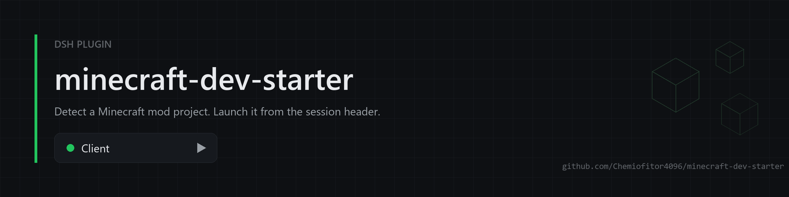
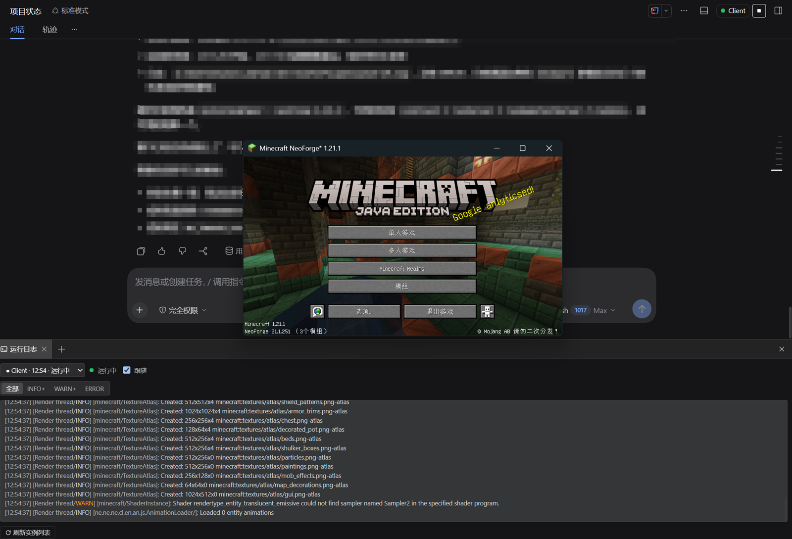
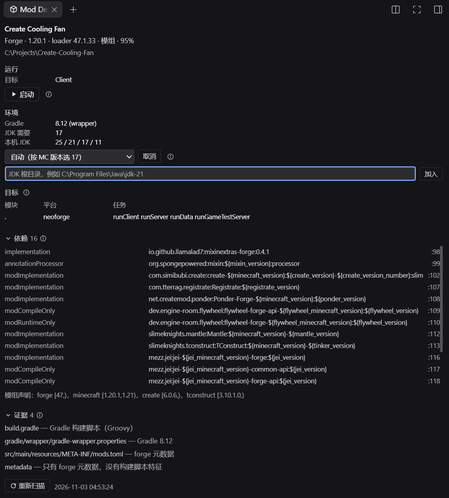
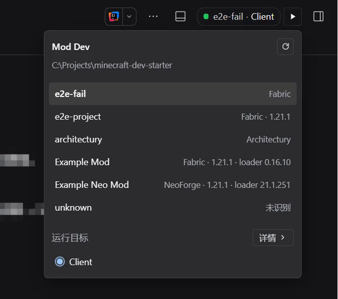

<div align="center">



# minecraft-dev-starter

**在 DeepSeek Harness 的会话标题栏里运行与验证 Minecraft 模组构建。**

[English](README.md) | 简体中文

<p>
  <a href="https://github.com/Chemiofitor4096/minecraft-dev-starter/actions/workflows/ci.yml"></a>
  <a href="https://www.npmjs.com/package/minecraft-dev-starter"></a>
  
</p>

</div>

插件识别当前工作区中的 Minecraft 模组与插件工程，在会话标题栏提供运行目标的选择与启动、停止操作，并将运行日志输出到侧边栏标签页。

面板服务于人，工具服务于模型，两者共用同一份运行状态和同一把锁：同一工程同时只有一个实例，谁先起的，另一方都看得见，也不会把对方的进程踩掉。

运行目标分两类，生命周期不同。`runClient` / `runServer` 是常驻进程，启动后一直运行到人关闭窗口；`runData` / `runGameTestServer` 会跑完，插件在它们结束时给出通过或失败的结论。模型因此可以自己完成"改代码 → 跑一遍 → 看结论"这一环，而不必让窗口里的画面承担它判断不了的事情。

## 截图

<table>
<tr><td colspan="2"></td></tr>
<tr>
<td width="50%"></td>
<td width="50%"></td>
</tr>
</table>

## 功能

- **工程识别**：支持 Fabric、Forge、NeoForge、Architectury、Paper 与 Spigot，覆盖 Minecraft 1.7.10 至 26.x。支持单模块、多模块与聚合仓库；loader 声明位于子模块时同样可以识别。
- **运行目标**：从 Gradle 配置中提取 Client、Server、Data、GameTestServer 等任务，并区分常驻（`daemon`）与会跑完（`oneshot`）两类。按 loader 惯例推测的目标会标记为未验证，不影响选择与启动。
- **托管启动**：通过 Gradle Wrapper 启动任务。常驻目标依据日志标记判定是否进入运行状态，而非仅依据进程存活；一次性目标跑完即给出结论，成功、失败、被停止、起不来分别可辨。停止时终止 Gradle 及其全部子进程。
- **JDK 选择**：按 MC 版本与 `toolchain` 推断所需 JDK 大版本，在面板里列出本机探测到的 JDK 供选择，也可以直接填入 JDK 根目录把它加进列表。指定结果只存本机（`~/.dsh/mc-dev-starter/jdk.json`），不写进 `gradle.properties`；启动时以 `-Dorg.gradle.java.home` 与 `JAVA_HOME` 传给 Gradle，因此面板显示的就是实际使用的。自动挑选只在"大版本完全匹配且 Gradle 跑得动"时接管，避免把本来能跑的工程换成不兼容的 JVM。
- **声明依赖**：解析 `dependencies { }` 块、`gradle/libs.versions.toml` 与元数据里的 `depends`，按配置、坐标、`文件:行号` 列出，用来核对某个依赖是不是真的加进去了。只显示声明；Gradle 解析后的传递依赖需要跑一次 Gradle 才能拿到。如果 IntelliJ 同步过这个工程，每条声明还会对照 IDE 库表里上次解析到的版本（不跑 Gradle）；「实际 x.y.z」只是提示，不是错误。
- **状态保持**：运行记录持久化到本地，并按 profile 分目录（`~/.dsh/mc-dev-starter/profiles/<name>/`），不同 profile 的实例互不干扰。宿主重启后按进程 ID 校验：确认存活则继续跟踪，无法确认则记为未知，不推测退出原因。
- **运行日志**：独立侧边栏标签页或 better-sidebar 底部工作台，按工程展示启动历史，支持跟随输出。日志按级别着色：WARN 与 ERROR 高亮，堆栈帧与 Gradle 任务行区分显示，时间、线程与 logger 弱化；可按级别过滤（全部 / INFO+ / WARN+ / ERROR），选择会被记住。异常退出时给出可能原因，覆盖依赖解析失败、JDK 版本不匹配、端口占用、认证失败等情况。
- **工作区跟随**：以当前会话的工作目录作为工作区，切换会话时自动重新扫描，无需手动刷新。工作区里没有可运行的工程时不显示标题栏胶囊，避免在非 Minecraft 项目里占位；面板标签仍可打开。
- **模型工具**（可选）：提供六个工具，与面板共用同一套服务——`mc_projects`（列出工程与目标）、`mc_project_detail`（loader 依据、模块、JDK、声明依赖、各目标是常驻还是会跑完）、`mc_launch`（启动；常驻目标默认等到运行态，一次性目标默认等到结束并返回 `verdict` 与失败行）、`mc_launch_logs`（读日志，异常退出时附带结构化归因与建议）、`mc_launch_list`（历史实例与状态，含验证结论）、`mc_launch_stop`（停止整棵进程树）。
- **扩展集成**：安装 [dsh-better-sidebar](https://github.com/topics/dsh-better-sidebar) 后，面板与日志可在其侧边栏中作为带图标的标签页打开。

## 安装

要求 DSH 桌面版 0.2.1 或更高版本，或对应的 `dsh` CLI。

```powershell
# 从 npm 安装
dsh plugin --profile desktop add minecraft-dev-starter

# 本地仓库（修改后即时生效）
dsh plugin --profile desktop add link:C:/Projects/minecraft-dev-starter

# 使用打包文件
dsh plugin --profile desktop add file:./minecraft-dev-starter-0.1.10.tgz
```

安装完成后需重启 DSH 生效。卸载：

```powershell
dsh plugin --profile desktop remove minecraft-dev-starter
```

`dsh plugin` 是 pnpm 的封装：将插件加入 profile 的依赖，并把声明了 `dsh.bundle` 的包加入 `dsh.profile.bundles` 列表。直接编辑 profile 的 `package.json` 后执行 `pnpm install`，效果相同。

## 使用

1. 打开包含 Minecraft 工程的工作区会话。
2. 标题栏显示当前选中的运行目标。点击目标名称打开浮层，从中选择工程与任务。
3. 需要换 JDK 时，在右侧栏「Mod Dev」面板的「构建环境」里选择：下拉列出本机 JDK，也可以在下方输入 JDK 根目录并添加。
4. 点击启动按钮开始构建并运行。启动后自动打开「运行日志」标签页，该行为可通过配置关闭。
5. 运行期间按钮切换为停止；点击后终止 Gradle 及其子进程。

浮层布局随工程数量变化：单工程工作区不显示工程列表，表头直接呈现工程名称、loader 与版本、路径；多工程工作区显示固定高度的列表，切换工程时仅更新下方目标区域，页面不会跳动。

### 验证改动

对会跑完的目标，模型可以直接拿到结论，不需要人盯着窗口：

1. `mc_project_detail` 看哪些目标是 `oneshot`，即 `runData`、`runGameTestServer`，以及工程里自建的 `runGametest`；
2. `mc_launch` 启动它。这类目标默认等到结束，返回 `verdict`：`passed` / `failed` / `aborted` / `error`；
3. 失败时 `summary` 是第一处失败特征行，`failures` 是命中的若干行；需要全文用 `mc_launch_logs`。

常驻目标（`runClient`）能自动断言的只有「是否进入运行状态」与日志里的异常。画面、手感这类判断仍由人完成：模型把客户端起起来，人看一眼，再让模型回去读日志。

## 配置

在 profile 的 `cordis.patch.yml` 中为该插件条目添加 `config` 字段：

```yaml
- id: mcdev-host
  name: minecraft-dev-starter
  config:
    autoOpenLogTab: true
    # logDock: right        # 默认：装了 dsh-better-sidebar 落底部工作台，没有则落右侧栏
    readyTimeoutMs: 90000
    logRingLines: 2000
```

| 配置项 | 类型 | 默认值 | 说明 |
|---|---|---|---|
| `autoOpenLogTab` | boolean | `true` | 启动后自动打开运行日志标签页 |
| `logDock` | `right` \| `bottom` | 自动 | 日志打开位置。未配置时安装 dsh-better-sidebar 则落其底部工作台，否则落原生右侧栏；写入 `right` 可强制回到右侧栏 |
| `readyTimeoutMs` | number | `90000` | 等待进入运行状态的超时时间；超时不计为失败 |
| `logRingLines` | number | `2000` | 内存中保留的日志行数；磁盘上的日志始终完整 |

`logDock` 只影响「自动打开」与面板里的「打开日志」按钮；无论配置为何，两个标签页都同时存在于原生右侧栏与 better-sidebar 的页签列表中，可随时手动打开。

## 兼容范围

| 平台 | 版本范围 | 说明 |
|---|---|---|
| Fabric | 1.14 – 26.x | loom 提供的 `runClient` 等任务 |
| Forge | 1.7.10 / 1.12.2 / 1.16.5 / 1.20.1 | 包含 legacyforge |
| NeoForge | 1.20.1 – 26.x | moddev 插件 |
| Architectury | 1.16 – 26.x | 按子模块拆分任务 |
| Paper / Spigot | 1.7.10 – 26.x | 服务端插件工程 |

JDK 版本按 Minecraft 版本推断：1.7.10 与 1.12.2 需要 Java 8，1.18 至 1.20.4 需要 Java 17，1.20.5 及以上需要 Java 21，26.x 需要 Java 25。插件将需求与已安装的 JDK 比对，缺失或版本不符时在面板中提示。

支持多模块工程：每个子模块各自算一个工程，运行目标带 Gradle 模块前缀（`:modules/core:runClient`），并在 wrapper 所在的聚合根目录执行。工程里有 IntelliJ 的 `.idea` 时，会额外读取它的 Gradle 模块清单、minecraft facet 平台、工程 JDK 与运行配置，但只作为**兜底**证据——构建脚本优先，已判定的结论不会被推翻。

已在 **dsh 0.2.1-rc.4**（DSH NEXT 2.0.21-next）+ Windows 11 上验证。宿主侧的变化记在 [CHANGELOG](./CHANGELOG.md)；上调支持范围按破坏性变更处理。

## 开发

```powershell
npm install
npm run build        # 构建客户端到 lib/client.js；修改 src/client 后必须执行
npm test             # 135 个测试
npm run check:pack   # 校验 npm 包里真的有客户端产物与源码
npm run build -- --watch
```

`lib/client.js` 被 `.gitignore` 忽略，只在打包时通过 `package.json` 的 `files` 进入 npm 包。因此新 clone 的仓库要先执行一次 `npm run build`，否则 `link:` 安装的插件拿不到客户端产物。`prepack` 会在 `npm pack` / `npm publish` 之前自动构建；`test/bundle.test.js` 按宿主的加载协议真跑一遍产物，客户端坏掉会在测试里失败，而不是等用户装完才发现。

CI 在 ubuntu、windows、macOS 三个平台与 Node 20/22/24 上跑测试，另有一个打包内容校验任务。

仓库结构、已知坑与历次验证结论见 [AGENTS.md](./AGENTS.md)。设计文档：[策划](./doc/策划.md)、[DSH 插件机制调研](./doc/调研-DSH插件机制.md)。

## 发布

DSH 插件以 npm 包形式分发，不需要独立注册流程。

1. **清单**：`package.json` 声明 `dsh.bundle.patch`（指向 `cordis.patch.yml`）；提供浏览器界面时同时声明 `dsh.client.platform`。宿主依据这两项识别插件。
2. **产物**：执行 `npm run build` 生成 `lib/client.js`。该文件被 `.gitignore` 忽略，通过 `package.json` 的 `files` 字段进入 npm 包。运行时直接读取产物，不安装依赖，也不执行构建。
3. **校验**：执行 `npm test` 与 `npm run check:pack`（直接问 npm 实际会打包哪些文件：缺 `lib/client.js`、源码或 README，或多带了 `test/`，都会失败）。
4. **发布**：`npm publish --access public`。若使用仅允许暂存的 granular token，改为以下流程：

   ```powershell
   npm stage publish                 # 提交到暂存区
   npm stage list                    # 等待校验结束
   npm stage approve <stage-id>      # 人工完成 2FA 确认
   ```

   暂存后由人工批准是 npm 的设计：机器提交、人工确认，即使 token 泄露也无法直接发布正式版本。批准后 `latest` 标签自动指向新版本。
5. **兼容性**：宿主 API 会持续演进。发布前将 `@deepseek-ai/dsh-tools` 与 `@deepseek-ai/cordis` 的版本范围对齐目标运行时；跨大版本时应分别发布版本，而非放宽范围强行兼容。
6. **安装**：用户执行 `dsh plugin --profile <name> add <包名>` 后重启，或在 Plugins 面板中安装。

在本地验证发布形态时，可先 `npm pack`，再通过 `dsh plugin add file:<tarball>` 安装；该路径与 npm 安装完全一致。

## 安全

报告渠道、支持范围与完整威胁模型见 [SECURITY.md](./SECURITY.md)。

- **会执行什么**：启动目标时会在工程目录里运行该工程自带的 Gradle wrapper（`gradlew.bat` / `gradlew`），环境变量继承自 DSH 宿主。也就是说工作区的构建脚本以你的用户权限运行——这与你自行执行 `gradle` 是同一种信任。插件只提供工作区内识别到的目标。
- **会写什么**：运行记录与日志写在 `~/.dsh/mc-dev-starter`（按 profile 分目录），JDK 选择记在同目录的 `jdk.json`。除 Gradle 自身产物外，不改动工程目录。
- **会发送什么**：不向外发送任何数据。`/mcdev/api` 由本机 DSH Web 服务提供并受其鉴权保护，客户端产物只向这些路由上报自身诊断。
- **子进程**：同一工程同时只有一个目标；停止时杀掉整棵进程树（Windows `taskkill /T`，POSIX 进程组），不留孤儿 `java` 进程。不做隐含的 `clean`，不删除构建目录。
- **包内容**：不声明任何依赖；用户机器上不执行安装脚本或 postinstall——`prepack` 只在发布者的工作区运行。

npm 页面上的两条告警来自宿主运行时，不是本包代码：

- `zod`（GHSA-mrhx-c7xc-m3w5）经 `@deepseek-ai/dsh-tools` → `@deepseek-ai/dsh-llm` 传导。本包不声明依赖，无法锁定它。
- 「Uses eval」是误报：命中的是 `@deepseek-ai/dsh-ptc-runtime` 保留字表里的一个字符串常量。本仓库与构建产物中都不出现 `eval`。

## 已知限制

- 原生右侧栏的标签类型不提供图标字段，图标仅支持 `dsh-better-sidebar` 中的标签。
- 子模块各自成工程后，聚合工程的根目录不再单列；根目录自己挂的 run 目标不会出现在列表里。
- `.idea` 只是兜底证据：既不在 `settings.gradle`、也不在 IDE 模块清单里的模块不会被发现；facet 平台也不会推翻已判定的 loader。
- 一次性目标的结论由退出码与日志特征共同判定：退出码非零必为失败；退出码为零但日志里出现测试失败特征（如 `N required tests failed`）同样判为失败，以免把「测试挂了但进程退了 0」当成通过。两者都缺失时记为未知，不猜。
- 在 Windows 上首次构建需要下载 Gradle 与项目依赖，耗时可能达到数分钟；后续构建可使用 Gradle daemon。

## License

MIT
